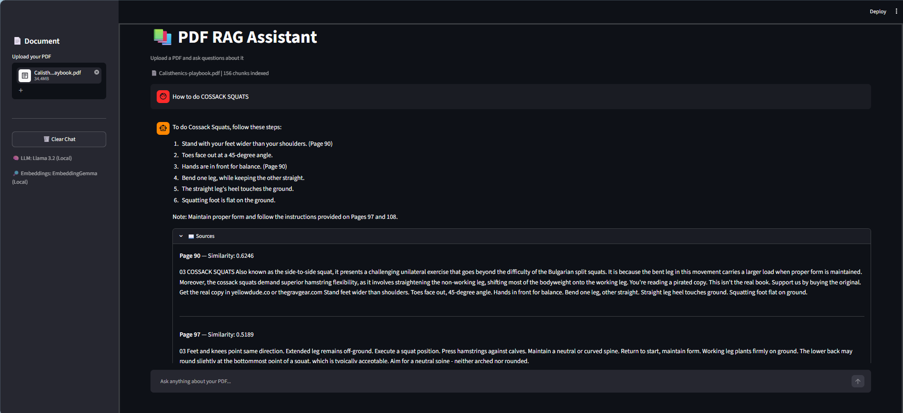

# Local PDF RAG

Ask questions about a PDF and get answers with page references. Everything runs on your machine: embeddings and generation go through Ollama, retrieval is plain NumPy, and there is no vector database or cloud API.

The point of this project is less the app than the evaluation. It includes a small benchmark that measures retrieval quality, citation behavior, and whether the model correctly refuses questions the document can't answer. The results, including the flaws in my own benchmark, are below.



## How it works

```
PDF -> pypdf (text + page numbers) -> overlapping chunks -> EmbeddingGemma -> NumPy matrix
Question -> EmbeddingGemma -> cosine similarity -> top 5 chunks -> Llama 3.2 -> answer + sources
```

- **Chunking:** 150 words per chunk with 20 words of overlap. Chunks never cross page boundaries, so every chunk keeps an exact page number.
- **Retrieval:** chunk embeddings are normalized, so cosine similarity is a single matrix product (`embeddings @ query`). Documents and queries are embedded with EmbeddingGemma's document and query prefixes.
- **Generation:** the top 5 chunks go to Llama 3.2 with instructions to answer only from the context, cite pages, and say so when the context is insufficient. These are prompt instructions, not guarantees, which is why the evaluation checks them.
- **Session handling:** the Streamlit app hashes the uploaded file, so reruns don't re-embed the same document.

## Evaluation

> **Preliminary results.** These are baseline numbers from a small benchmark, and they are known to be off (see Caveats). Don't quote them without the caveats.

I tested against *Introduction to Networks: Connecting Digitally* (Khokhar and Tran, Georgia Gwinnett College, CC BY 4.0). The index has 168 chunks from <<state which pages or chapters were indexed>>. The dataset has 43 questions: 35 answerable (26 direct, 3 paraphrased, 4 comparisons, 2 multi-section) and 8 unanswerable.

**Hardware:** Intel i5-12500H, 16 GB RAM, RTX 3050 (4 GB VRAM). 

### What the retrieval metrics mean

- **Hit@5:** the share of questions where a chunk from the expected page appears in the top 5.
- **Recall@5:** the share of expected pages found in the top 5, for questions with more than one expected page.
- **MRR:** the average of 1 / rank of the first correct chunk, so finding it at rank 1 scores 1 and at rank 4 scores 0.25.
- **nDCG@5:** a score that rewards putting correct chunks higher in the top 5.

### Retrieval (35 answerable questions)

| Metric | Result |
| --- | --- |
| Hit@5 | 85.7% (30/35) |
| Recall@5 | 84.3% |
| MRR | 0.754 |
| nDCG@5 | 0.769 |

### Generation

| Metric | Result |
| --- | --- |
| Abstained on unanswerable questions | 8/8 |
| Answered answerable questions (no false abstention) | 35/35 |
| Included a page citation | 85.7% (30/35) |
| Cited a page that was actually retrieved | 85.0% (<<N of M citations>>) |
| Expected-keyword coverage | 96.2% |

### Latency

| Metric | Time |
| --- | --- |
| Retrieval, average | 0.30 s |
| Generation, average | 2.65 s |
| Total, median / P95 | 2.06 s / 8.75 s |

### Caveats

- **Some ground-truth page labels are wrong.** Several expected pages in `evals/dataset.json` use the textbook's printed page numbers, while the parser uses physical PDF pages. This understates retrieval scores. I'm correcting the labels and will rerun.
- **The model has the same confusion.** It sometimes cites a printed page number instead of the PDF page.
- **Perfect abstention is a weak signal.** 8/8 on unanswerable questions and 35/35 on answerable ones comes from a very small sample, and abstention is detected by phrase matching. It may reflect my prompt and the wording of my questions more than real robustness.
- **Keyword coverage is not accuracy.** It checks that expected terms appear, not that the answer is correct.
- **Citation provenance is weak.** It checks that a cited page was among the retrieved chunks, not that the page supports the claim.
- **Small sample.** With 35 answerable questions, one question moves a metric by about 3 points.
- **No faithfulness score yet.** The evaluator writes `manual_review.csv` for hand-grading correctness and groundedness. I haven't reported a faithfulness number because that review isn't done.

<!-- TODO after fixing the page labels: add a small table of single-setting changes
(chunk size, top_k, query/document prefixes on or off) with Hit@5 and MRR for each run. -->

## Setup

Requires Python 3.10+ and [Ollama](https://ollama.com/download).

```bash
git clone https://github.com/adityabasu-dev/Local-PDF-RAG.git
cd Local-PDF-RAG
python -m venv venv
venv\Scripts\activate          # Linux/macOS: source venv/bin/activate
pip install -r requirements.txt

ollama pull embeddinggemma
ollama pull llama3.2
streamlit run app.py
```

Open http://localhost:8501, upload a text-based PDF in the sidebar, and ask a question. Expand "Sources" under an answer to see the retrieved passages and pages.

## Reproducing the benchmark

```bash
# 1. Point the PDF path in build_index.py at the textbook, then:
python build_index.py            # writes data/index.npy and data/index.json
python -m evals.evaluator        # writes evals/results/{report,summary}.json and manual_review.csv
```

The Streamlit app builds its index in memory per upload. The evaluator uses the saved index so runs are repeatable.

## Project layout

```
app.py             Streamlit UI and session state
rag.py             Chunking, embedding, retrieval, prompt, generation
build_index.py     Builds the persistent index used by the evaluator
evals/
  dataset.json     43 questions with expected pages, keywords, answerability
  evaluator.py     Metrics, latency, manual-review export
```

`data/` and `evals/results/` are generated locally and don't need to be committed.

## Limitations

- Scanned PDFs need OCR first. Only PDFs with a text layer work.
- One document at a time.
- Cosine similarity always returns a top 5, even when nothing relevant exists. Refusal currently depends on the LLM, not on a similarity threshold.
- Splitting by page can separate related content that spans a page break.
- Citations can be wrong or unsupported.
- This is a standard retrieve-then-generate pipeline. It is not an autonomous agent.

## Planned work

- Fix benchmark page labels and rerun
- Similarity threshold for out-of-scope questions
- Reranking and hybrid keyword + semantic search
- Automated groundedness checks
- Multi-document support

## License and credits

Code is released under the MIT License (see `LICENSE`).

Evaluation text: *Introduction to Networks: Connecting Digitally* by Umar Khokhar and Binh Tran (Georgia Gwinnett College), licensed under [CC BY 4.0](https://creativecommons.org/licenses/by/4.0/). Source: https://oer.galileo.usg.edu/compsci-textbooks/17/. The benchmark questions are my own, written from the book's content.

Built with Llama, Ollama, Streamlit, and Google's EmbeddingGemma.